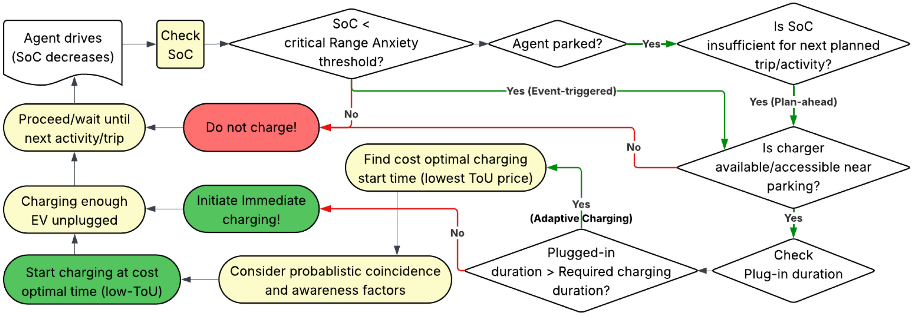
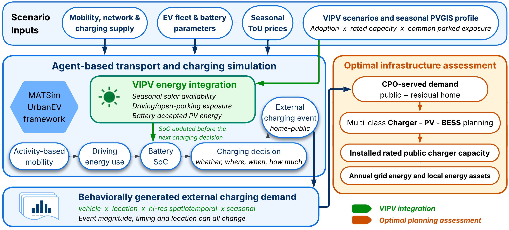

# Agent-based simulation for Cost-aware, Adaptive and VIPV-enabled EV Charging

---
UrbanEV-v2 extends UrbanEV for **spatiotemporal EV charging-demand estimation** in MATSim, combining **cost-aware charging**, **ToU-aware adaptive charging**, and optional **vehicle-integrated photovoltaics (VIPV)**. The `VIPVmain` branch supports both noVIPV baseline simulations and seasonal VIPV studies within the same framework.

<p align="center">
  
</p>

<p align="center"><em>Simulated EV Charging User Behavior.</em></p>


Use [`VIPVmain`](https://github.com/parishwadomkar/UrbanEV-v2/tree/VIPVmain) for current development and applications. The [`master`](https://github.com/parishwadomkar/UrbanEV-v2/tree/master) branch retains the original implementation associated with the [charging-demand article](https://doi.org/10.1016/j.trd.2026.105285).

---

## What this repository enables (vs. [`UrbanEV`](https://doi.org/10.3390/wevj12010018))

UrbanEV-v2 preserves UrbanEV's **multi-criteria charging behavior** and charging-infrastructure logic while extending the framework in three main directions:

1. **Cost-aware charging scoring**  
   Charging decisions internalize monetary charging costs through additional utility terms, allowing different tariffs for home, work, and public charging.

2. **Adaptive ToU-aware smart charging**  
   For eligible home-charging activities, charging can be deferred within the available parking window toward lower-cost periods. The response is controlled through configurable awareness, temporal-shift, and coincidence parameters.

3. **Vehicle-integrated photovoltaic generation**  
   A selected share of EVs can be equipped with VIPV using an explicit vehicle cohort. Solar electricity is generated during driving and during probabilistically selected open-parking episodes. Generated energy is added directly to vehicle battery SoC subject to battery-capacity limits, while excess energy is recorded as wasted/curtailed PV energy.

The selected simulation `season` controls both the **seasonal ToU profile** and the **seasonal PV potential profile**.

<p align="center">
  
</p>

<p align="center"><em>VIPV integration within the charging-demand simulation and its connection to infrastructure and energy planning.</em></p>

---

## Key features

- Multi-day MATSim simulations, including 7+ day / 170+ hour activity plans.
- Public charging infrastructure and person-specific home/work charging access.
- Battery SoC evolution from driving consumption, grid charging, and optional VIPV.
- Multi-criteria charging choices with range-anxiety, walking-distance, and SoC-balance utilities.
- Charger-type tariffs and optional ToU-aware home-charging rescheduling.
- Seasonal profiles for **SPRING, SUMMER, AUTUMN, and WINTER**.
- Explicit VIPV vehicle cohorts, driving/open-parking exposure, and produced/stored/curtailed PV accounting.
- Charging and VIPV event outputs for spatial, temporal, and vehicle-level analysis.

---

## Inputs

### 1) Population plans (MATSim population v6)

EV charging behavior uses person attributes including:

- `rangeAnxietyThreshold`
- `homeChargerPower` (kW)
- `workChargerPower` (kW)
- `smartChargingAware` (boolean; assigned at runtime from `awarenessFactor` unless already provided)

### 2) Electric vehicles (UrbanEV / EV DTD)

Electric vehicles are provided through the UrbanEV EV XML and contain battery capacity, initial SoC, vehicle type, and compatible charger types.

### 3) Vehicle types (`vehicletypes.xml`)

Vehicle types define energy consumption and charging-relevant vehicle parameters used by UrbanEV.

### 4) Chargers (`chargers_v1.dtd`)

Public chargers are defined by location/link, charger type, plug power, and plug count.

### 5) VIPV vehicle cohort (VIPV runs)

VIPV-equipped vehicles can be specified using `pvVehiclesFile`.
The current loader uses the vehicle ID only. VIPV rated power is controlled globally through `pvWp`.

The scenario runner requires its specified cohort CSV for VIPV cases. Missing files, malformed records, duplicate IDs, unknown fleet IDs, or a cohort size inconsistent with the positive `pvShare` stop the run. Leave `pvVehiclesFile` empty for noVIPV.

---

## Repository layout (Gothenburg, Sweden)

- `src/main/java/se/urbanEV/` : UrbanEV-v2 Java sources
  - `charging/`  : charging logic, ToU cost handling, and smart charging
  - `discharging/`  : driving and auxiliary energy consumption
  - `fleet/`  : EV fleet and battery representation
  - `scoring/`  : EV-specific and charging-cost scoring
  - `stats/`  : charging and SoC statistics
  - `pv/`  : VIPV generation and statistics
- `src/main/python/Opti/`  : [seasonal charging-infrastructure and energy planning](src/main/python/Opti/)
- `scenarios/`  : MATSim scenario inputs
- `pom.xml`  : Maven configuration

A scenario typically contains:

- MATSim config (`config.xml`)
- network (`network.xml(.gz)`)
- population (`plans.xml(.gz)`)
- chargers (`chargers.xml`)
- electric vehicles (`electric_vehicles.xml`)
- vehicle types (`vehicletypes.xml`)
- optional VIPV vehicle CSV

---

## Configuration: `urban_ev` module

The `urban_ev` config group contains the inherited UrbanEV parameters together with the cost-aware, smart-charging, seasonal, and VIPV controls.

### noVIPV baseline

Set `pvWp`, `pvShare`, and `pvParkedOpenShare` to `0`, and `pvVehiclesFile` to an empty string. Select the corresponding `scenarioName` and `controler.outputDirectory` from the [scenario matrix](scenarios/sweden/vipv-scenario-matrix.csv). Keep the selected season and behavioural parameters consistent across controlled noVIPV/VIPV comparisons.

### Example: seasonal smart charging + VIPV

```xml
<module name="urban_ev">
    <param name="parkingSearchRadius" value="500"/>
    <param name="defaultRangeAnxietyThreshold" value="0.2"/>
    <param name="vehicleTypesFile" value="vehicletypes.xml"/>
    <param name="rangeAnxietyUtility" value="-8"/>
    <param name="emptyBatteryUtility" value="-12"/>
    <param name="walkingUtility" value="-1"/>
    <param name="homeChargingUtility" value="0"/>
    <param name="socDifferenceUtility" value="-10"/>
    <param name="maxNumberSimultaneousPlanChanges" value="2"/>
    <param name="timeAdjustmentProbability" value="0.2"/>
    <param name="maxTimeFlexibility" value="600"/>

    <param name="generateHomeChargersByPercentage" value="false"/>
    <param name="homeChargerPercentage" value="80"/>
    <param name="defaultHomeChargerPower" value="11"/>
    <param name="generateWorkChargersByPercentage" value="false"/>
    <param name="workChargerPercentage" value="20"/>
    <param name="defaultWorkChargerPower" value="11"/>

    <!-- Charger costs -->
    <param name="homeChargingCost" value="2.5"/>
    <param name="workChargingCost" value="4.0"/>
    <param name="publicChargingCost" value="5.5"/>
    <param name="betaMoney" value="-0.06"/>          <!-- 0.0 disables monetary charging-cost scoring -->
    <param name="alphaScaleCost" value="0.5"/>

    <!-- Smart charging -->
    <param name="enableSmartCharging" value="true"/> <!-- false disables smart rescheduling -->
    <param name="alphaScaleTemporal" value="0.2"/>
    <param name="awarenessFactor" value="0.3"/>
    <param name="coincidenceFactor" value="0.7"/>    <!-- higher = lower dispersion -->

    <!-- Seasonal ToU + VIPV -->
    <param name="scenarioName" value="10pct_AUTUMN_VIPV50_Wp400_open50"/>
    <param name="season" value="AUTUMN"/>            <!-- SPRING, SUMMER, AUTUMN, WINTER -->
    <param name="pvVehiclesFile" value="scenarios/sweden/10pct/50VIPV_10pct.csv"/>
    <param name="pvParkedOpenShare" value="0.50"/>  <!-- probability per parking episode -->
    <param name="pvShare" value="0.50"/>            <!-- must match the explicit cohort -->
    <param name="pvWp" value="400.0"/>              <!-- Wp per VIPV; 0 disables VIPV generation -->
</module>
```

Use the matching output directory from the scenario matrix. The XML above is the `urban_ev` section of a complete MATSim configuration.

### Parameter interpretation

#### Charging cost and smart charging

- `homeChargingCost`, `workChargingCost`, `publicChargingCost`: base charging tariffs by charging context. Sweden scenarios interpret these as SEK/kWh.
- `betaMoney`: marginal utility of money used to convert charging expenditure into utility. `0.0` removes charging cost from EV scoring.
- `alphaScaleCost`: multiplicative calibration factor applied to the monetary utility term.
- `enableSmartCharging`: enables ToU-aware home-charging start-time rescheduling.
- `alphaScaleTemporal`: controls the temporal shift applied when searching for preferred low-ToU charging periods.
- `awarenessFactor`: share/probability of agents assigned as ToU-aware.
- `coincidenceFactor`: controls dispersion of deferred charging starts; higher values produce less spread around preferred start times.

#### Seasonal and VIPV controls

- `season`: selects the seasonal ToU and PV profiles. Supported values are `SPRING`, `SUMMER`, `AUTUMN`, and `WINTER`.
- `pvVehiclesFile`: authoritative CSV of VIPV vehicle IDs; invalid explicit files are rejected.
- `pvShare`: VIPV fleet fraction `[0,1]`, consistent with the scenario label and explicit cohort size.
- `pvWp`: rated VIPV capacity in Wp applied to each equipped vehicle; use the complete noVIPV settings above for a control run.
- `pvParkedOpenShare`: probability `[0,1]` that each parking episode of a VIPV is exposed to open-sky solar conditions. For example, `0.50` means that approximately half of parking episodes are treated as solar-exposed.

---

## VIPV simulation logic

For a VIPV-equipped vehicle, the instantaneous PV power is calculated from the configured rated power and the selected seasonal PV potential. The seasonal hourly factors are stored in `PvPotentialUtils` and are based on the PVGIS profiles used for the Gothenburg scenarios:

```text
PV power = pvWp × seasonal PV potential factor(hour)
PV energy = PV power × exposure duration
```

VIPV generation is applied:

- continuously while the vehicle is **driving**;
- while **parked** only when the current parking episode is sampled as open according to `pvParkedOpenShare`;
- independently of plug-in charging, so solar generation can also contribute while a solar-exposed vehicle is parked and charging.

Generation is integrated over exposure intervals and synchronized before plug-in charging updates. Accepted energy is added directly to the battery, subject to its capacity:

```text
PV produced = PV stored + PV wasted
```

Energy that cannot be stored because the battery is full is recorded as wasted/curtailed VIPV energy.

---

## Outputs

UrbanEV-v2 produces the standard MATSim outputs together with EV and VIPV-specific statistics.

Typical outputs include charging-demand time series and spatial distributions; charging context, timing, and costs; vehicle SoC profiles; ToU load-shifting effects; and VIPV generation during driving and open parking.

VIPV-enabled runs additionally produce:

```text
<iteration>.pv_charging_instances.csv
```

This file records contiguous generation intervals: vehicle ID, start/end times, exposure mode (`DRIVING` or `PARKED_OPEN`), PV energy produced/stored/curtailed, and start/end battery SoC. These outputs support controlled comparisons of external charging demand, timing, and seasonal solar contribution.

Demand outputs can also be supplied to [UrbanEV-Opti](src/main/python/Opti/) for public charger, stationary PV, and BESS planning. Its configuration and execution are documented within that module.

---

## Requirements

- **JDK 17 recommended**, compiling to Java 11 bytecode for **MATSim 12.0**
- **Maven 3.9.x**

Memory requirements depend strongly on the simulated population sample and number of iterations.

---

## Run from console

Clone the current framework branch and build the executable jar:

```bash
git clone --branch VIPVmain https://github.com/parishwadomkar/UrbanEV-v2.git
cd UrbanEV-v2
mvn clean install
```

Run a scenario by supplying its MATSim configuration file:

```bash
java -Xms16g -Xmx16g -jar target/*jar-with-dependencies.jar <path-to-config.xml>
```

For larger 10% scenarios, increase the JVM memory allocation as required by the available hardware.

---

## License

GPL-3.0, consistent with UrbanEV / MATSim licensing constraints. See `LICENSE`.

The project builds on contributions from the MATSim community. Classes adapted from upstream projects retain the corresponding author information, modification notices, and original license text where applicable.

---

## Contact / support

**Omkar Parishwad**  
Urban Mobility Research Group  
Chalmers University of Technology  
mail: omkarp@chalmers.se

For bugs, questions, or collaboration, please open a GitHub Issue in this repository. For MATSim-core or MATSim-EV questions, consult the MATSim documentation and community channels.

---

## Associated Articles

The cost-aware and adaptive framework used by both noVIPV and VIPV studies is described in:

- **Parishwad, Omkar; Gao, Kun; Najafi, Arsalan**, *Integrated and Agent-Based Charging Demand Prediction Considering Cost-Aware and Adaptive Charging Behavior*. **Transportation Research Part D: Transport and Environment**, 154 (2026) 105285.
  DOI: https://doi.org/10.1016/j.trd.2026.105285

Related infrastructure-planning methodology is described in:

- **Parishwad, Omkar; Najafi, Arsalan; Yang, Ying; Gao, Kun**, *User-redirection-aware co-optimization of public charging with local photovoltaics and battery storage*. **Advances in Applied Energy**, 24 (2026) 100310.
  DOI: https://doi.org/10.1016/j.adapen.2026.100310  
  Reference code: https://github.com/parishwadomkar/Large-scale-LBBD-Optimization

Additional project context:

- **Omkar Parishwad — PhD Thesis / Chalmers publication page**  
  https://research.chalmers.se/publication/547894


UrbanEV-v2 is rooted in the original UrbanEV framework:

- **Adenaw, L.; Lienkamp, M.**, *Multi-Criteria, Co-Evolutionary Charging Behavior: An Agent-Based Simulation of Urban Electromobility*. **World Electric Vehicle Journal**, 12(1), 18 (2021).
  DOI: https://doi.org/10.3390/wevj12010018
- Upstream UrbanEV codebase: https://github.com/TUMFTM/UrbanEV

---
