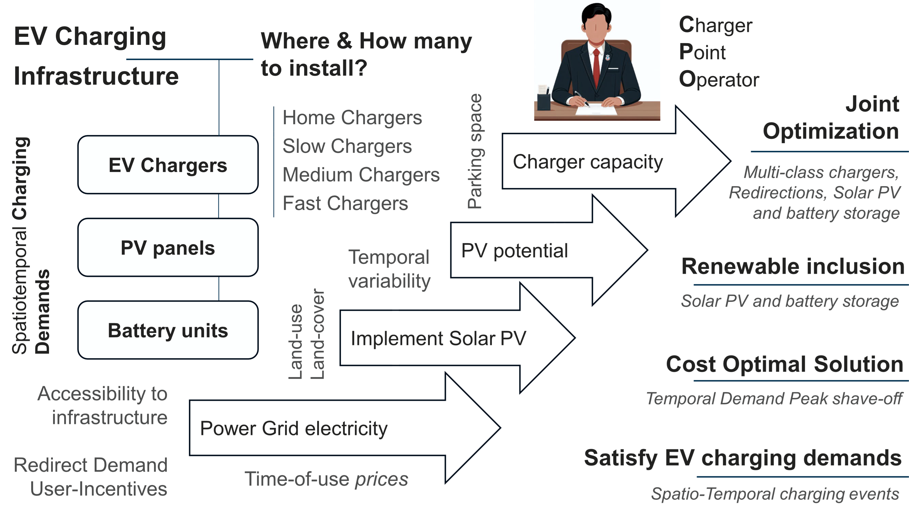
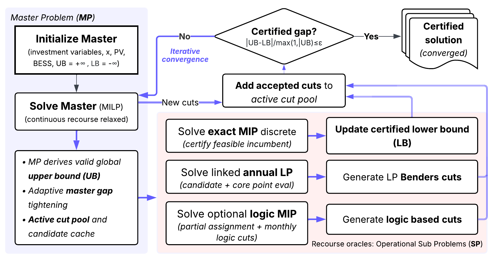

# UrbanEV-Opti: seasonal infrastructure and energy planning

## Public charging with stationary PV and BESS

UrbanEV-Opti optimizes public charging infrastructure, stationary photovoltaic (PV) capacity, battery energy storage systems (BESS), and energy dispatch using seasonal charging demand. Vehicle-integrated PV (VIPV) affects the supplied demand; stationary PV is an infrastructure decision. This Python module belongs to the [UrbanEV-v2 repository](https://github.com/parishwadomkar/UrbanEV-v2/tree/VIPVmain).

<p align="center">
  
</p>

## Model scope

One annual infrastructure plan serves four seasonal demand profiles through twelve monthly representative days, each with 48 half-hour intervals. The objective maximizes annual CPO profit after electricity purchases, redirection compensation, unmet-demand costs, and annualized investment. Private home chargers are exogenous. The configuration supports ten VIPV demand treatments and optional user redirection.

The formulation, decomposition methods, validation experiments, and reference execution examples are documented in the [original optimization repository](https://github.com/parishwadomkar/Large-scale-LBBD-Optimization) and the [associated paper](https://doi.org/10.1016/j.adapen.2026.100310). Local configuration and solver settings are described below.

<p align="center">
  
</p>

The workflow illustration is reproduced from the reference repository. Without redirection, spatial mode solves independent annual site MILPs; it does not perform Benders iterations.

## Implemented workflows

| Workflow | Entry point |
| --- | --- |
| Monolithic MILP | `src/run_optimization.py` |
| LBBD, including exact spatial mode without redirection | `src_lbbd/run_lbbd.py` |
| Benders benchmark | `src_benders/run_benders.py` |
| Method comparison | `src/compare_runs.py` |
| Scenario comparison within one method | `src/compare_scenarios.py` |

Monolithic infrastructure regularization also uses annual site solves when redirection is disabled. Include this phase in timing comparisons. The numbered Windows launchers in `scripts/`, `scripts_lbbd/`, and `scripts_benders/` accept dataset and VIPV treatment as positional arguments. Explicit resource settings can be supplied through the Python entry points.

## Input and configuration

Input files are selected by `config/paths.json`. The optimization consumes seasonal demand, spatial installation limits, shortest-path distances, PVGIS generation, and electricity prices. The required schemas and configuration controls are listed in [config/README.md](config/README.md); [model assumptions](assets/MODEL_ASSUMPTIONS.md) describe the planning boundaries.

`PublicRes`, `homeChar`, and `Panels` are used as supplied. Public resource budgets and home-charger counts are not increased or divided during optimization. Charger resource weights constrain installation space; they do not change charger power.

Command-line arguments override `config/run_profiles.json`. Scientific parameters are in `config/model_config.json`; base Gurobi settings are in `config/solver_gurobi.json`.

## Installation

Use Python 3.12 and an activated local environment. Run these commands from `src/main/python/Opti`:

```powershell
python -m pip install -r requirements_opti.txt
python -c "import pyomo.environ as pyo; print(pyo.SolverFactory('gurobi').available())"
```

Gurobi must be licensed locally. Retrieve actual input files if Git LFS is used, and keep shapefile companion files together. Check configured inputs before solving:

```powershell
python scripts/validate_inputs.py --dataset full --all-scenarios
```

## Optimization runs

The following commands use a local PC with **64 GB RAM**, four solver threads, and a **55 GB Gurobi SoftMemLimit**. Run them sequentially from Opti. Chargers, stationary PV, BESS, and figure generation are enabled; redirection is disabled.

### noVIPV

Monolithic:

```powershell
python src/run_optimization.py --dataset full --vipv-scenario noVIPV --scenario no_redirection --regularize-infrastructure --regularization-profit-tolerance 1 --threads 4 --time-limit 14400 --mip-gap 0.00001 --soft-mem-limit-gb 55 --nodefile-start 0.5 --root-method dual --node-method dual --pre-sparsify 1 --generate-figures
```

LBBD entry point, exact spatial mode:

```powershell
python src_lbbd/run_lbbd.py --dataset full --vipv-scenario noVIPV --scenario no_redirection --no-redirection-mode spatial --regularize-infrastructure --regularization-profit-tolerance 1 --threads 4 --subproblem-threads 2 --time-limit 28800 --mip-gap 0.00001 --soft-mem-limit-gb 55 --nodefile-start 0.5 --generate-figures
```

### VIPV50–700 Wp

Monolithic:

```powershell
python src/run_optimization.py --dataset full --vipv-scenario VIPV50_Wp700 --scenario no_redirection --regularize-infrastructure --regularization-profit-tolerance 1 --threads 4 --time-limit 14400 --mip-gap 0.00001 --soft-mem-limit-gb 55 --nodefile-start 0.5 --root-method dual --node-method dual --pre-sparsify 1 --generate-figures
```

LBBD entry point, exact spatial mode:

```powershell
python src_lbbd/run_lbbd.py --dataset full --vipv-scenario VIPV50_Wp700 --scenario no_redirection --no-redirection-mode spatial --regularize-infrastructure --regularization-profit-tolerance 1 --threads 4 --subproblem-threads 2 --time-limit 28800 --mip-gap 0.00001 --soft-mem-limit-gb 55 --nodefile-start 0.5 --generate-figures
```

The requested gap is 0.001%. Regularization minimizes annualized asset cost within a total profit allowance of SEK 1/year, subject to solver tolerances. SoftMemLimit applies to Gurobi; Python and the operating system require additional memory. Construction, export, and plotting add wall time. Inspect the achieved certificate for each run.

Use `--disable-pv` or `--disable-bess` for technology comparisons. Coupled runs use `--scenario with_redirection`; consult the reference repository and paper for decomposition settings and benchmark execution.

## Comparisons

Compare methods on the same demand treatment and model assumptions:

```powershell
python src/compare_runs.py --monolithic-run "runs/MONOLITHIC_FOLDER" --lbbd-run "runs/LBBD_FOLDER" --skip-complexity-recompute
```

Compare demand treatments within the same method:

```powershell
python src/compare_scenarios.py --method lbbd --comparison-axis vipv --run "runs/NOVIPV_FOLDER" --run "runs/VIPV50_WP700_FOLDER" --label "noVIPV" --label "VIPV50-700 Wp" --baseline-index 1 --skip-input-recompute
```

Replace folder placeholders with completed runs. Comparison tools check input/code identities and convergence records. Keep code and configuration consistent across a comparison.

## Outputs

Each run creates a timestamped directory under the configured run root.

| Output | Contents |
| --- | --- |
| `README_RUN.txt`, `run_context.json` | Terminal transcript, input/code identities, effective settings, and package versions |
| `run_metadata.json`, `results/solver_certificate.json` | Method, termination, incumbent, valid bound, and achieved gap |
| `results/model_summary.csv`, `results/infrastructure_by_hex.csv` | Annual economics, energy, and cell-level infrastructure |
| `results/hourly_energy.csv`, `results/energy_by_charger_type.csv` | Dispatch and charger utilization |
| `results/combined_results.xlsx` | Exported tables; oversized tables remain CSV-only |
| `results/resource_usage.csv`, `results/computational_complexity_table.csv` | Process memory, model size, and timing |
| `figures/figures_manifest.csv` | Generated, skipped, or failed figure groups |

Method-specific histories record site solves or decomposition iterations. Figures cover infrastructure, economics, seasonal energy, dispatch, utilization, and convergence. Comparison workbooks are written under `runs/comparisons/` by default.

## Development

```powershell
python -m pip install -r requirements_dev.txt
python scripts/check_repository.py
python -m flake8 src src_lbbd src_benders scripts tests --select=E9,F63,F7,F82,F401,F811,F841
python -m pytest -q tests
```

The parent repository's [Python CI workflow](../../../../.github/workflows/ci.yml) runs these checks on Linux and Windows with synthetic fixtures and HiGHS; a Gurobi license and production inputs are not required. The Java workflow is separate. [Dependabot](../../../../.github/dependabot.yml) tracks Python and GitHub Actions dependencies. [AGENTS.md](AGENTS.md) provides scoped contributor and coding-assistant guidance.

## References and support

Parishwad, O.; Najafi, A.; Yang, Y.; Gao, K. (2026). *User-redirection-aware co-optimization of public charging with local photovoltaics and battery storage*. Advances in Applied Energy. [doi:10.1016/j.adapen.2026.100310](https://doi.org/10.1016/j.adapen.2026.100310).

Parishwad, O.; Gao, K.; Najafi, A. (2026). *Integrated and Agent-Based Charging Demand Prediction Considering Cost-Aware and Adaptive Charging Behavior*. Transportation Research Part D: Transport and Environment. [doi:10.1016/j.trd.2026.105285](https://doi.org/10.1016/j.trd.2026.105285).

Framework illustrations: [Large-scale-LBBD-Optimization](https://github.com/parishwadomkar/Large-scale-LBBD-Optimization).

Omkar Parishwad, Chalmers University of Technology: [omkarp@chalmers.se](mailto:omkarp@chalmers.se). Implementation issues can be reported in the [UrbanEV-v2 issue tracker](https://github.com/parishwadomkar/UrbanEV-v2/issues).
